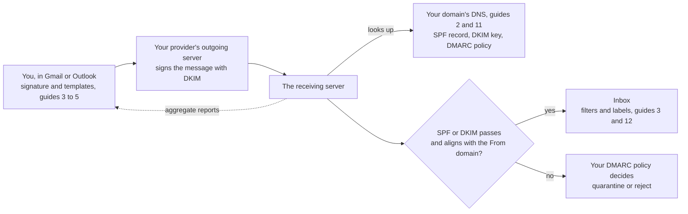

# email-setup-kit

[](https://github.com/zaccesss/email-setup-kit/actions/workflows/build-templates.yml)
[](https://github.com/zaccesss/email-setup-kit/actions/workflows/markdownlint.yml)
[](https://github.com/zaccesss/email-setup-kit/releases/latest)
[](LICENSE)

A complete guide to setting up email on your own domain: choosing a provider, DNS that passes SPF,
DKIM and DMARC, moving from an old provider, security, inbox organisation, accessible signatures and
Outlook templates built from code.

## What is inside

| Folder | What it gives you |
| --- | --- |
| [`guide/`](guide/) | Step-by-step guides, from domains and DNS to filters, signatures and Outlook |
| [`signatures/`](signatures/) | `signature-builder.html`: fill in your details, preview and copy accessible signatures straight into Gmail or Outlook |
| [`gmail/`](gmail/) | `filters-example.xml`: an importable filter set with nested labels and quiet GitHub notifications |
| [`outlook/`](outlook/) | A Python builder that turns plain text into importable Outlook `.oft` templates |

## Start here

Work through [CHECKLIST.md](CHECKLIST.md). The guides can also be read in order:

| # | Guide | Covers |
| --- | --- | --- |
| 0 | [Choosing a setup](guide/00-choosing-a-setup.md) | Hosted mailbox, forwarding or sending service |
| 1 | [Domains and mailboxes](guide/01-domains.md) | Alias domains, role addresses, switching domain types, parking a domain |
| 2 | [Deliverability](guide/02-deliverability.md) | SPF, DKIM and DMARC that actually pass |
| 3 | [Gmail](guide/03-gmail.md) | Send-as, signature defaults, labels and filters |
| 4 | [Accessible signatures](guide/04-signatures.md) | Signatures that work for everyone |
| 5 | [Outlook](guide/05-outlook.md) | Signatures, rules and templates on Microsoft 365 |
| 6 | [Gotchas](guide/06-gotchas.md) | Problems that are hard to spot until they bite |
| 7 | [Forwarding](guide/07-forwarding.md) | A free setup with Cloudflare Email Routing and Gmail |
| 8 | [Migration](guide/08-migration.md) | Moving from an old provider without losing mail |
| 9 | [Sending services](guide/09-sending-services.md) | Websites, newsletters and contact forms |
| 10 | [Security](guide/10-security.md) | Accounts, domains, MTA-STS, TLS-RPT and BIMI |
| 11 | [DNS reference](guide/11-dns-reference.md) | Every record in one table |
| 12 | [Inbox habits](guide/12-inbox-habits.md) | Daily habits, out-of-office, phones and teams |
| 13 | [How providers differ](guide/13-provider-differences.md) | Gmail, Outlook, Apple Mail, Proton Mail and Fastmail compared, including how HTML renders |

> [!TIP]
> Replace every `example.com` and `Your Name` with your own details. The builder page and the filter
> file have them in obvious places.

## How the pieces fit

One message leaving your domain and what each guide covers along the way:



## Building Outlook templates

```bash
python3 -m venv .venv
.venv/bin/pip install -r outlook/requirements.txt
.venv/bin/python outlook/build_oft.py
```

The `.oft` files land in `outlook/build/`. Import them in Outlook on the web under Settings, Email,
Templates, Add, Add OFT.

## Licence

[MIT](LICENSE).
